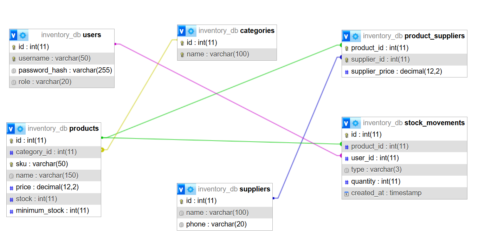
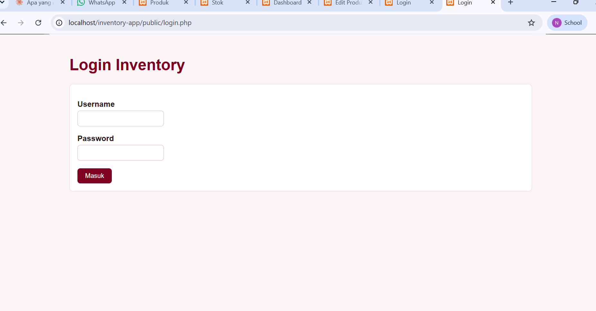
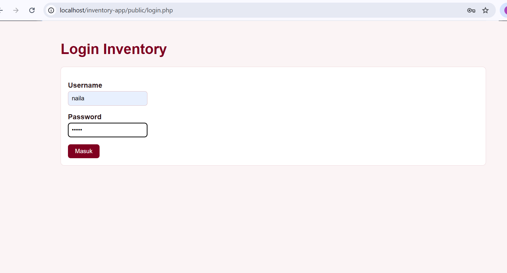
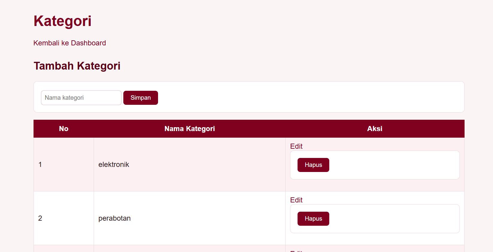
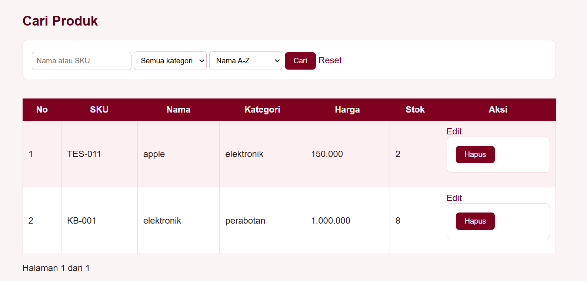
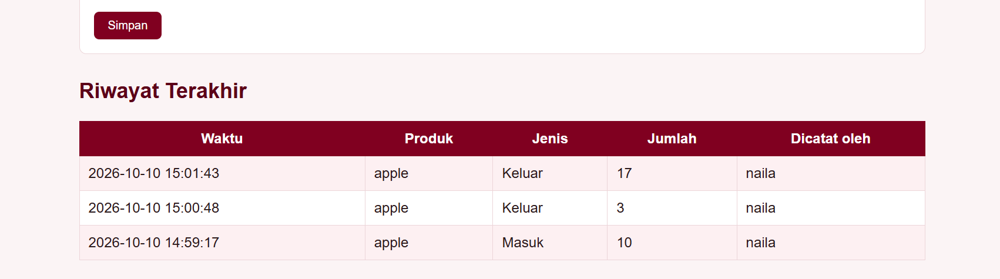
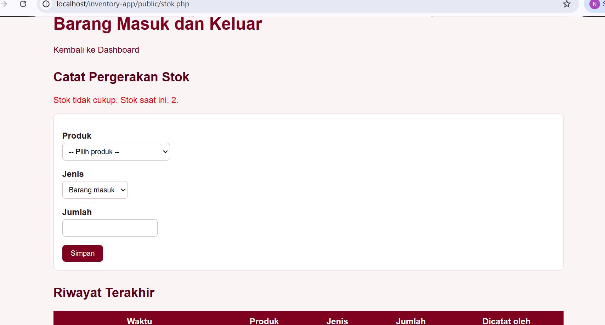
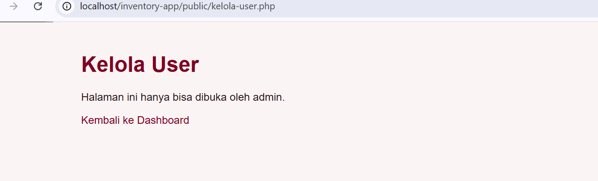

# Inventory Management System

Aplikasi web untuk mengelola stok barang di sebuah toko. Dibuat untuk Mini Project 3 mata kuliah Pemrograman Web.

Dibuat oleh: Naila Amelia

## Teknologi

- PHP (PDO)
- MySQL (XAMPP)
- HTML dan CSS

## Cara Menjalankan

1. Salin folder `inventory-app` ke `htdocs` di XAMPP.
2. Nyalakan **Apache** dan **MySQL** di XAMPP Control Panel.
3. Buka phpMyAdmin, buat database bernama `inventory_db`.
4. Jalankan isi file `database/schema.sql` di tab SQL.
5. Buat satu akun admin di tabel `users` (password disimpan dalam bentuk hash, bisa dibuat dengan `password_hash()` di PHP).
6. Buka `http://localhost/inventory-app/public/login.php`.
7. Setelah login sebagai admin, akun lain bisa dibuat lewat menu **Kelola User**.

## ERD

Struktur database terdiri dari 6 tabel. Skema lengkapnya ada di `database/schema.sql`.

| Relasi | Jenis | Implementasi |
| --- | --- | --- |
| `categories` ke `products` | One-to-many | Foreign key `products.category_id` |
| `products` dan `suppliers` | Many-to-many | Junction table `product_suppliers` dengan composite primary key |
| `products` ke `stock_movements` | One-to-many | Foreign key `stock_movements.product_id` |
| `users` ke `stock_movements` | One-to-many | Foreign key `stock_movements.user_id` |

## Fitur

- **Login dan logout** dengan password yang di-hash (`password_hash` dan `password_verify`).
- **Role admin dan staff**, dengan akses yang berbeda.
- **Kategori**: lihat, tambah, ubah, hapus.
- **Produk**: lihat, tambah, ubah, hapus.
- **Supplier**: lihat, tambah, ubah, hapus (admin).
- **Produk dan Supplier** (many-to-many): satu produk bisa punya banyak supplier beserta harga dari tiap supplier.
- **Pencarian** produk berdasarkan nama atau SKU.
- **Filter** produk berdasarkan kategori.
- **Pengurutan** produk berdasarkan nama, harga, atau stok.
- **Pagination** daftar produk.
- **Barang masuk dan keluar** dengan transaction.
- **Dashboard**: total produk, kategori, supplier, total stok, nilai inventory, total barang masuk, total barang keluar, dan daftar produk yang stoknya menipis.
- **Laporan inventory**: ringkasan per kategori (COUNT, SUM, AVG) dan per produk (total masuk, total keluar, stok saat ini, nilai stok).
- **Kelola User** (admin): lihat, tambah, dan hapus user.

## Hak Akses

| Fitur | Admin | Staff |
| --- | --- | --- |
| Melihat dashboard, kategori, produk, supplier, laporan | Ya | Ya |
| Mencatat barang masuk dan keluar | Ya | Ya |
| Menambah dan mengubah kategori dan produk | Ya | Ya |
| Menghapus kategori dan produk | Ya | Tidak |
| Menambah, mengubah, menghapus supplier | Ya | Tidak |
| Mengatur relasi produk dan supplier | Ya | Tidak |
| Kelola User | Ya | Tidak |

## Business Rule

1. SKU produk harus unik. Kalau SKU sudah dipakai, produk ditolak.
2. Harga dan jumlah barang tidak boleh negatif.
3. Barang keluar tidak boleh melebihi stok yang tersedia.
4. Stok tidak boleh menjadi negatif.
5. Setiap barang masuk dan keluar dicatat di tabel `stock_movements`, lengkap dengan waktu dan user yang mencatat.
6. Perubahan stok dan pencatatan riwayat dilakukan dalam satu transaction. Kalau salah satu gagal, semuanya dibatalkan (rollback).
7. Produk yang sudah punya riwayat barang masuk atau keluar tidak bisa dihapus.
8. Kategori yang masih dipakai produk tidak bisa dihapus.
9. Supplier yang masih terhubung ke produk tidak bisa dihapus.
10. Pasangan produk dan supplier tidak boleh dobel. Kalau dipilih lagi, harga supplier diperbarui.
11. Semua halaman internal membutuhkan login.
12. Hanya admin yang boleh menghapus kategori dan produk, mengelola supplier, mengatur relasi produk dan supplier, serta membuka halaman Kelola User. Staff ditolak dengan pesan "Akses ditolak".
13. Admin tidak bisa menghapus akunnya sendiri, dan user yang sudah punya riwayat barang masuk atau keluar tidak bisa dihapus.
14. Pengurutan daftar produk hanya memakai pilihan yang diizinkan (nama, harga, stok).

## Keamanan

- **Prepared statement** (PDO) untuk semua query yang memakai input pengguna, untuk mencegah SQL Injection.
- **Output encoding** dengan `htmlspecialchars` untuk mencegah XSS.
- **Validasi di server** untuk semua form (format dan makna bisnis).
- **Password hashing** dengan `password_hash`.
- **Session** dengan `session_regenerate_id` setelah login.
- **Otorisasi** dicek di server, bukan hanya dengan menyembunyikan menu.

## Screenshot

### Login

### Dashboard

### Kategori

### Produk (pencarian, filter, sorting, pagination)

### Barang Masuk dan Keluar

### Validation Error (stok tidak cukup)

### Akses Terlarang (staff membuka halaman admin)

